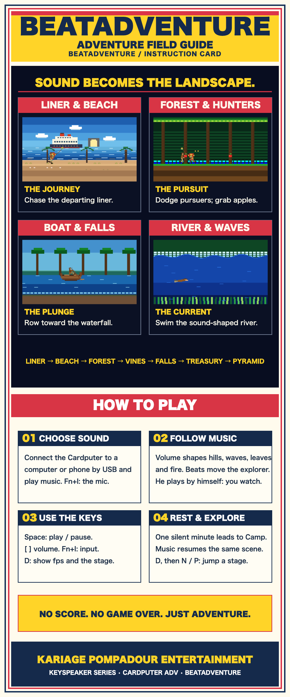

# BeatAdventure

**After the space war, the next stage is an ancient ruin. The beat stirs my soul.**

<table>
<tr>
<td valign="top" width="480">

BeatAdventure is a music-driven adventure game for the M5Stack Cardputer ADV (240 x 135 screen). Play any music, and an explorer runs,
climbs, swims and falls through a jungle, a treasure vault and an ancient pyramid, to the beat. Loud parts brighten the world and bring more
danger; quiet parts darken it and make everything wait. **You do not play; you watch and listen.**

It is a sister of [KeySpeaker](https://github.com/kariagepompadour/Cardputer-ADV-KeySpeaker): the same firmware (USB speaker, USB and BLE
keyboard, air mouse, jog dial, built-in microphone, Pico 2 AUX unit, MP3 from a microSD card) with the game as its screen.

**Play the web demo in your browser first: https://kariagepompadour.github.io/BeatAdventure-WEB-DEMO/**
This firmware was ported from it, and the web demo is the reference for how everything should look and behave.

[日本語](README_JA.md)

</td>
<td valign="top" width="360">


</td>
</tr>
</table>

## Why you only watch

Even with no money, just being in the arcade was thrilling.

Then a new game arrived. It looked wonderful, but the 100 yen in your pocket (a quarter, if you grew up in the US) was too precious to spend.
So you stood behind the kid who was playing, the coin in your fist slick with sweat from excitement, looking over their shoulder. That was
enough. And in your head you kept muttering: "I wouldn't do it like that." "Not there, more to the right!"

BeatAdventure is made for that feeling. You press no button and insert no coin. The explorer goes on his adventure by himself, to your
music. Whether he falls into a pit or ducks a boulder, you can stay where you always stood, behind him, watching and backseat-gaming in your
head.

"Go on, you can do it!"

## What you will see

One long journey that loops. Every place reacts to the music:

1. **The liner**: he climbs the ladders of a ship, one rung on every beat, and walks down the gangway.
2. **The beach**: a departing ship, a monkey throwing coconuts from a palm, turtles and logs to jump, a masked hunter, and a bush to hide
   behind when the music goes quiet.
3. **The forest and the wall**: tigers, bears, apples; then a landslide he climbs, with falling rocks and condors.
4. **The vine ravine, the boat and the falls**: three vines across a ravine, then a boat over a waterfall.
5. **The river and the flat forest**: crocodiles, piranhas and water snakes; ponds crossed by a vine; a golden mask on a pedestal and a hidden shaft.
6. **The tunnel and the treasury**: arrow traps, a rolling boulder, a mine cart, guardians who chase him; then ten floors of ladders, gaps, ropes
   and gold, and the golden mask on the top floor. A missed jump drops him into a river, which carries him up a water jet and down to
   **the pyramid**, where three boulders roll down the steps and he crouches under each one. Then the forest again.
7. **The camp**: after more than a minute without music he sits by a fire under falling code, eats, and sleeps until sound returns; then the
   same scene goes on, one day later.

There is no text on the game screen while it plays, except two short titles in the treasury ("THE TREASURY" on arrival, "GOLDEN MASK" when he
takes the mask).

<a href="docs/images/field_guide_en.png"></a>

(Click the card to see it large.)

## What you need

- An M5Stack **Cardputer ADV**.
- Music. Connect the Cardputer to a computer or phone by USB: it appears as a USB speaker, so you play music through it, and the game
  listens to what you play. (The built-in microphone is also available, as in KeySpeaker; it has not been re-tested with the game.)

## Install

There is no ready-made image yet: build it yourself, then install the app through a launcher.

```bash
firmware/build.sh BeatAdventure_S0
```

This needs `arduino-cli`, the `m5stack:esp32` core 3.3.10 and the libraries M5Cardputer, M5Unified and M5GFX (the settings are those of
KeySpeaker; see `firmware/build.sh`). It makes the app-only `BeatAdventure_S0.ino.bin`, about 1.2 MB. Install that file through a launcher.
Do not use the Arduino IDE's **Upload**: it also writes the bootloader and the partition table.

If your launcher's web upload fails (on the one device it was tried on it failed with "Update Fail: 3"), check the size of the launcher's
app slot. On that device the slot was about 1.18 MB, smaller than the image, which was the likely cause (not proven).

## Using it

- `Space` plays and pauses, `,` and `/` go to the previous and next track (or jump in an MP3), `[` and `]` change the volume, `\` mutes,
  `Fn` + `I` switches the input (USB, microphone, AUX, MP3), `Fn` + `M` switches the screen, `h` shows the help. These are KeySpeaker's keys;
  see its README for the full list.
- `d` shows small numbers on the game screen: frames a second, analysis and drawing times, beats a second, the stage, the day and the tempo.
  While they are shown, `n` and `p` jump to the next and previous stage, to look at a place without waiting for it.

## Good to know

All the stages of the web demo are ported. Each was run on one Cardputer ADV over USB audio as it was added: about 28 to 30 frames a second,
4 to 16 ms of drawing a frame (the treasury is the busiest place), about 87 KB of heap left. Two things from development:

- An early build crashed at start-up, because the game runs on the 8 KB loop-task stack and one function built a large state on it. That is
  fixed, and `firmware/build.sh` now refuses a build in which a game function uses more than 2.5 KB of stack.
- Once, in an early treasury build, the screen froze while the music kept playing. It did not happen again in about 20 minutes of watching and
  could not be reproduced on a computer; the cause is unknown. Since then the loop watchdog is on and the serial log records where the loop
  was. What the device does when the watchdog fires has not been tested.

The microphone input, BLE, the Pico 2 AUX unit and MP3 playback come from KeySpeaker and have not been re-tested with the game.

## For developers

- `firmware/BeatAdventure_S0/beatadv.h`: a C++ port of the web demo's beat tracker (`beat.js`) and its sound analysis; on a computer it gives
  the same results as the web demo's own test.
- `ba_game.h` (the stages), `ba_hero.h` (the explorer, a skeleton drawn as thick lines) and `ba_gfx.h` (the drawing layer): plain C++ with no
  Arduino headers, so the same code runs on a computer. `host/preview.cpp` draws the game there, for comparing with the web demo.
- Tests (a computer only, needs only a C++ compiler):

  ```bash
  host/run_tests.sh
  ```

  They run the beat tracker against the same synthetic signals as the web demo's `test/beat.test.js`, the sound analysis, the game's rules
  stage by stage (the treasury, the waterway, the pyramid, the camp and others), and a whole run of one hour with random music, quiet
  stretches and long silences under the address and undefined-behaviour checkers.

## Similar tools by the same author

- [KeySpeaker WEB DEMO](https://github.com/kariagepompadour/KeySpeaker-WEB-DEMO)
- [Cardputer-ADV-KeySpeaker](https://github.com/kariagepompadour/Cardputer-ADV-KeySpeaker): the firmware this one grew from.
- [BeatAdventure WEB DEMO](https://github.com/kariagepompadour/BeatAdventure-WEB-DEMO): the reference for the game
  ([play it in the browser](https://kariagepompadour.github.io/BeatAdventure-WEB-DEMO/)).

## License

MIT License. Copyright (c) 2026 Kariage POMPADOUR Entertainment Corporation. See [`LICENSE`](LICENSE).
`firmware/BeatAdventure_S0/minimp3.h` is minimp3 (CC0, see `minimp3_LICENSE.txt`).
